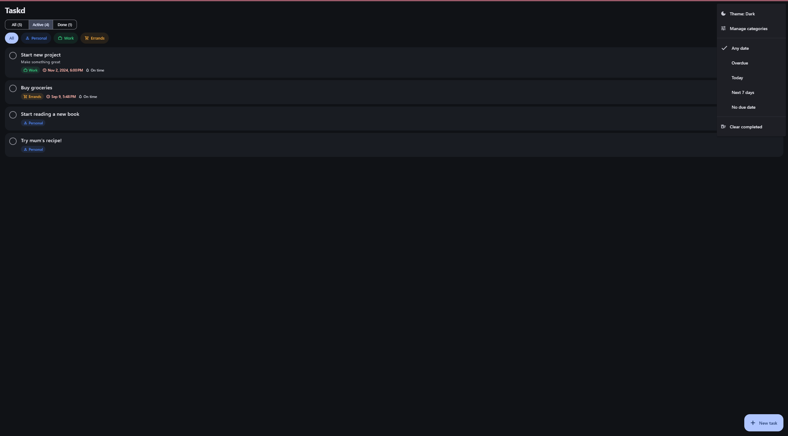
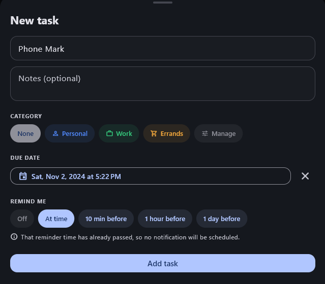
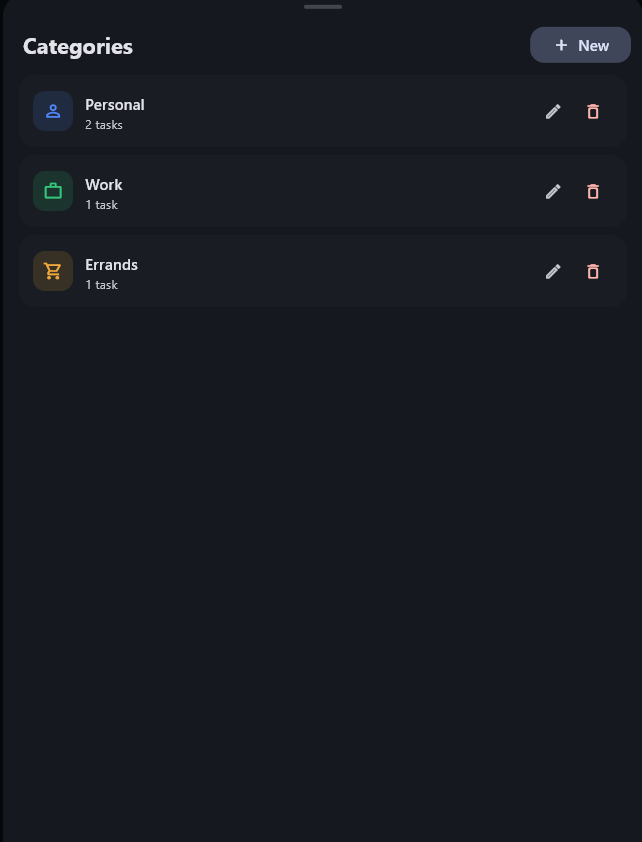
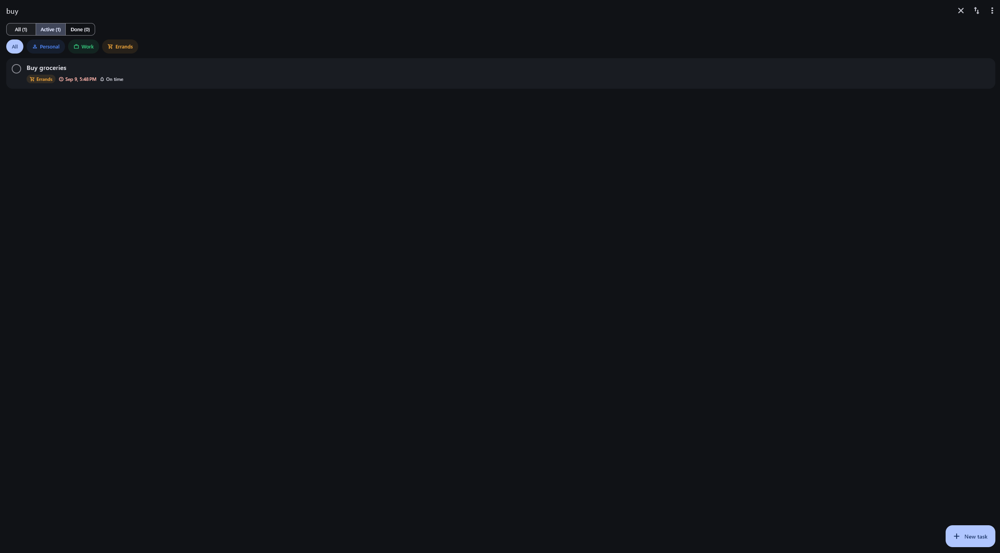

# Taskd

A to-do app I built to get more comfortable with Flutter and state management.

It works entirely offline. There's no backend, no account, and it never makes a
network call.

Runs on Android and Windows.

## Stack

- Flutter
- Riverpod for state management
- Hive for local storage

## Features

- Create, edit, complete and delete tasks
- Categories and due dates, with filtering, sorting and search
- Local notifications for reminders, with a per-task lead time
- Light and dark themes
- Everything is saved on the device

## Screenshots

The task list, with the menu open for theme, categories and date filters:



Adding a task, and managing categories:

<p>
  
  
</p>

Searching:



## Getting started

You'll need Flutter 3.32.x. For Android, the Android SDK. For Windows, Visual
Studio 2022 with the "Desktop development with C++" workload.

```bash
flutter pub get
dart run build_runner build --delete-conflicting-outputs
flutter run
```

Tests are `flutter test`. They cover the filtering and sorting logic plus the
completion animation, and don't need a device.

## How it's put together

Widgets read from providers, providers go through repositories, and only the
repositories touch Hive. Nothing skips a layer.

```
lib/
  models/      data classes, plus the filter and sort logic
  data/        repositories, the only place Hive is used
  providers/   Riverpod state
  screens/     task list, task editor, category manager
  widgets/     task tile, strikethrough animation, filter bar
  core/        theme, notifications, date formatting
```

Filtering and sorting both happen in `visibleTasksProvider`, so the list and the
counts on the tabs can't drift apart.
